# Mecânica DM - Workorder API (Ordem de Serviço)

[](https://sonarcloud.io/project/overview?id=mecanica-dm_mecanicadm-workorder-api-v4)


API de **Ordem de Serviço** (OS Service) do sistema **Mecânica DM**: cadastros, abertura e ciclo de vida da OS, fila de execução, estoque e consulta de status e histórico. Participa da saga publicando eventos do que aconteceu na OS e executando os commands que a saga manda (autorizar, pedir alterações, cancelar, liberar o veículo).

Na **Fase 04** do 15SOAT, a aplicação foi refatorada para **microsserviços independentes** (Workorder, Finance e Saga), cada um com repositório, banco e pipeline próprios, que se integram por mensageria e mantêm a consistência das transações críticas com o **Saga Pattern**. Esta API **não chama os outros serviços por HTTP**: toda a integração é por mensageria (RabbitMQ), e o banco é só dela.

---

## 📚 Documentação Externa e Modelagem

- **[Storytelling (Egon.io)](https://github.com/user-attachments/assets/fd2adfad-1fa9-469d-958a-1cf902666b36)**: Storytelling inicial do fluxo de funcionamento da mecânica.
- **[Dicionário de Dados (Notion)](https://lopsided-hourglass-4f8.notion.site/Dicion-rio-de-dados-32f0a8ca8e738075ae44c9ec0b5180b3?source=copy_link)**: Visão detalhada das entidades e relacionamentos do banco de dados (modelagem da Fase 03).
- **[Event Storming (Miro)](https://miro.com/app/board/uXjVIT7cD_4=/?share_link_id=217316260154)**: Mapeamento de domínio e comportamento orientado a eventos do sistema.
- **[Dashboard do SonarCloud](https://sonarcloud.io/project/overview?id=mecanica-dm_mecanicadm-workorder-api-v4)**: Análise contínua de qualidade de código, vulnerabilidades e cobertura de testes.

### Componentes de infraestrutura (Fase 03)

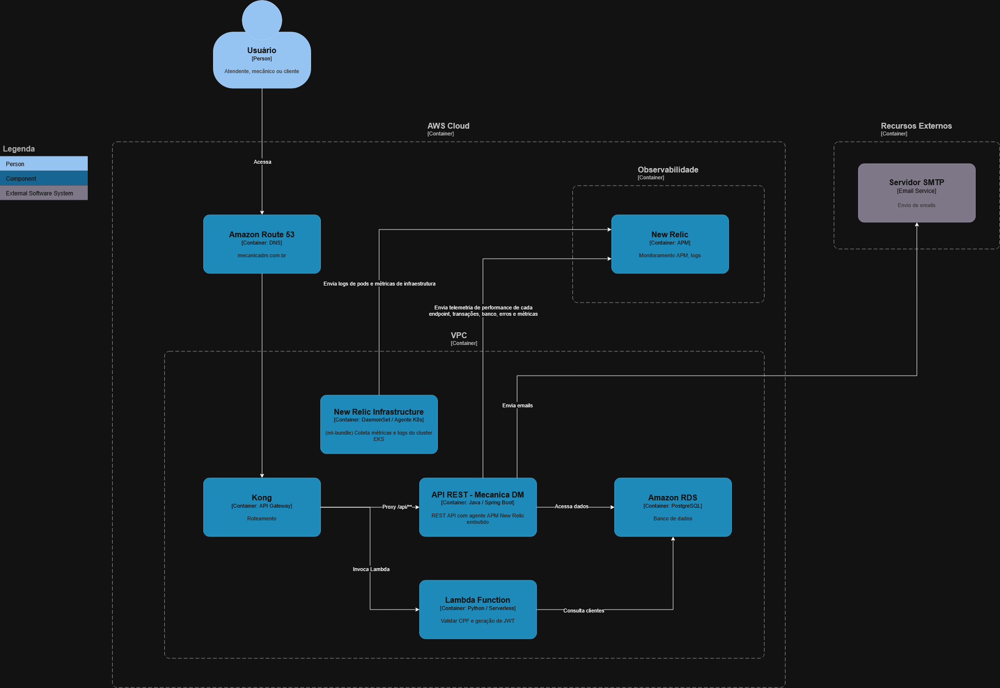

### Componentes da aplicação (Fase 03)

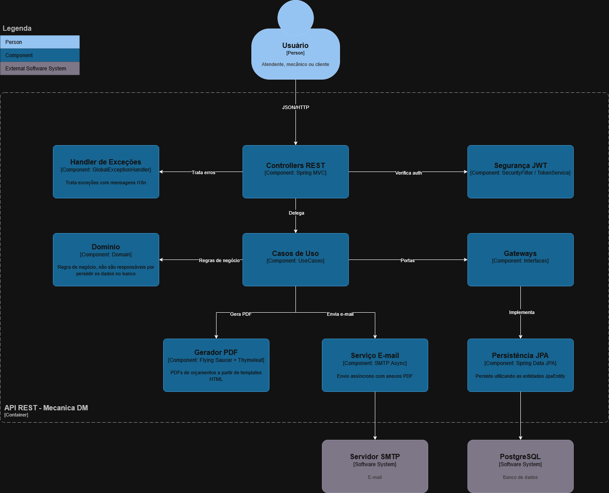

### Arquitetura geral do sistema (Fase 04)

Três microsserviços, cada um com o seu banco, falando só por mensageria. A saga hospeda o broker e conduz o fluxo.

<div align="center">

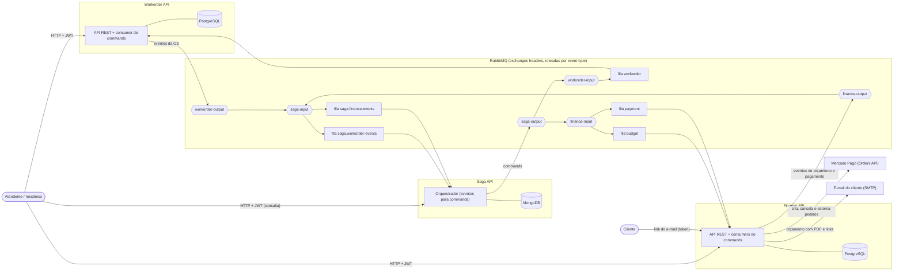

</div>

### Fluxo de CI/CD

[Link para imagem do fluxo](docs/assets/fluxo-deploy-fase-03.png)

<div align="center">

```mermaid
flowchart LR
    TRIGGER[Disparo do Workflow] --> COND{Evento}
    COND -->|push em main| M1[Branch: main]
    COND -->|pull_request| PR[Pipeline PR]
    COND -->|workflow_dispatch| WD[Manual]

    M1 --> BUILD
    PR --> BUILD
    WD --> BUILD

    subgraph BUILD[build-and-test]
        direction LR
        A1[Checkout]
        A2[Setup JDK 21]
        A3[mvn clean verify]
        A4[Análise Sonar]
        A1 --> A2 --> A3 --> A4
    end

    subgraph SEC[security-scan]
        direction LR
        S1[Checkout]
        S2[Subir aplicação]
        S3[ZAP Scan OpenAPI]
        S4[Upload Relatório]
        S5[Parar containers]
        S1 --> S2 --> S3 --> S4 --> S5
    end

    BUILD -->|sucesso| SEC
    SEC -.->|job publish-and-deploy, comentado no workflow| FIM[Publicação e deploy K8s]
```

</div>

* build-and-test: Responsável por fazer o maven build, executar os testes unitários e de integração e a análise do Sonar.
* security-scan: Rodamos o ZAP Scan para verificar problemas de segurança.
* publish-and-deploy: O job que publica a imagem no Docker Hub e dispara o deploy no K8s está preparado no workflow, mas **comentado**.

### Diagrama de Entidade-Relacionamento

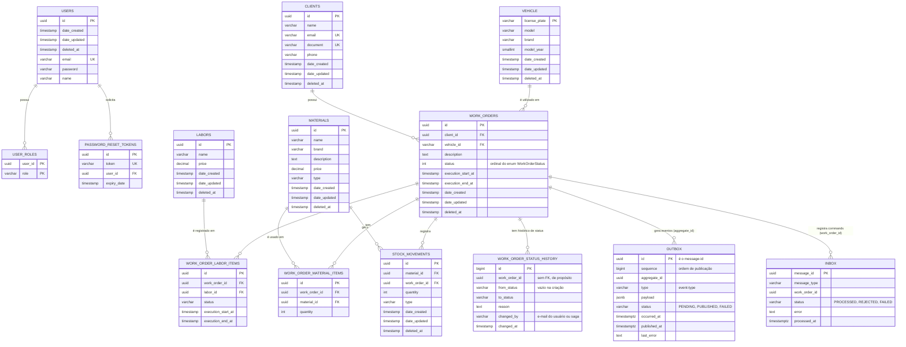

### Diagramas de sequência

#### Caminho feliz de uma OS (Fase 04)

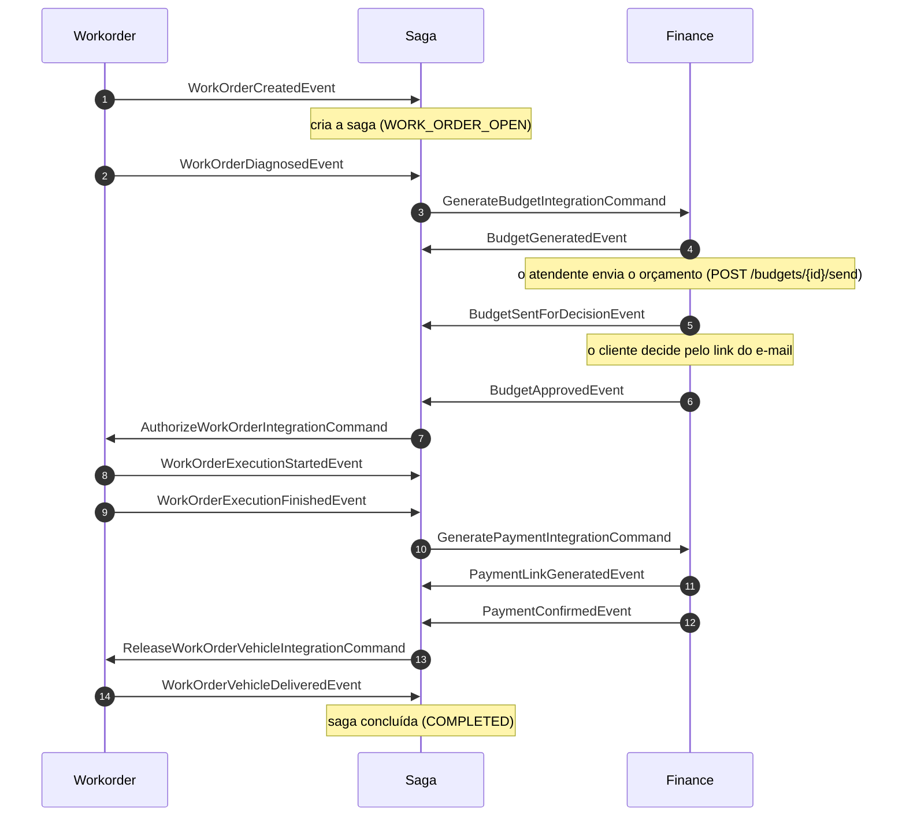

#### Ciclo de vida da OS (status)

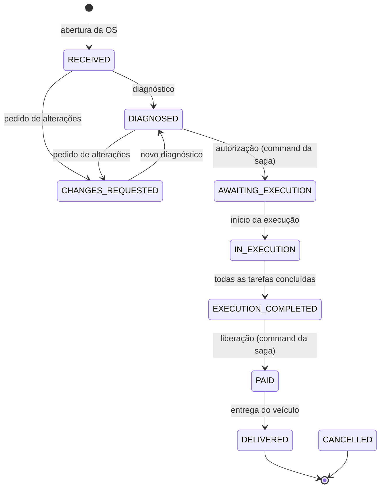

O cancelamento vale em **qualquer** status (a saga precisa compensar em qualquer fase) e leva a `CANCELLED`.

#### Fluxo de Autenticação (Fase 03)

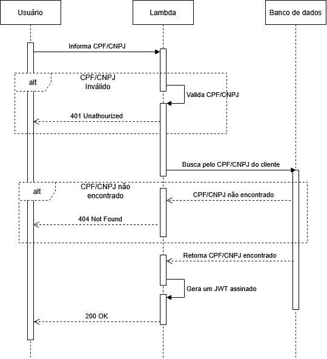

---

## ✨ Funcionalidades Principais

- **🔩 Gestão de Ordens de Serviço**: Ciclo de vida completo, desde a criação, diagnóstico, execução até a entrega, com transições validadas pela própria entidade.
- **🕘 Histórico de Status**: Cada mudança de status é registrada com o status anterior e o novo, o motivo, quem mudou (o usuário ou a saga) e quando.
- **👤 Gestão de Clientes e Veículos**: Cadastro e consulta de clientes e veículos.
- **📦 Controle de Estoque**: Gerenciamento de materiais, com dedução automática de estoque ao adicionar em uma O.S. e devolução ao cancelar.
- **🛠️ Catálogo de Serviços (Mão de Obra)**: Cadastro dos serviços prestados pela oficina e fila de execução das tarefas de cada OS.
- **🎼 Participação na Saga**: Publica os eventos da OS e executa os commands da saga (autorizar, pedir alterações, cancelar, liberar o veículo); quando recusa um command, avisa a saga com o `WorkOrderCommandRejectedEvent`.
- **🔐 Autenticação e Autorização**: Segurança baseada em JWT (emitido aqui e validado pelos três serviços) e criptografia de credenciais.
- **📊 Analytics**: Endpoints para extração de métricas e relatórios de tempo de execução.
- **🌐 Suporte a Múltiplos Idiomas**: Mensagens de erro e validação em Português, Inglês e Espanhol.

> 💰 O orçamento (geração, envio, decisão do cliente e impressão em PDF) e o pagamento ficaram na **Finance API**.

---

## 🚀 Tecnologias Utilizadas

| Categoria        | Tecnologia                                                   |
|------------------|--------------------------------------------------------------|
| **Core**         | Java 21, Spring Boot 3.4                                     |
| **Dados**        | Spring Data JPA, PostgreSQL, Flyway (Migrations)             |
| **Mensageria**   | RabbitMQ (Spring AMQP), padrão Outbox/Inbox                  |
| **Segurança**    | Spring Security, JWT (Java JWT)                              |
| **Documentação** | Springdoc (Swagger/OpenAPI 3)                                |
| **Testes**       | JUnit 5, Mockito, REST Assured, Testcontainers (PostgreSQL e RabbitMQ) |
| **Qualidade**    | JaCoCo, SonarCloud                                           |
| **Build**        | Maven                                                        |
| **Container**    | Docker, Docker Compose                                       |

> ‼️ O banco utilizado foi PostgreSQL, a justificativa formal para o uso desse banco se encontra na **RFC 002 - Escolha do Banco de Dados** que pode ser acessada na seção RFCs.

---

## 🏛️ Arquitetura e Decisões

O projeto segue uma arquitetura limpa, inspirada em princípios de _Clean Architecture_ e _Domain-Driven Design (DDD)_, para garantir separação de responsabilidades, testabilidade e manutenibilidade. As diretrizes de código são guiadas por **Architecture Decision Records (ADRs)** armazenadas no projeto.

Arquitetura limpa, separada por funcionalidade: o `core` não depende de framework, e a `infra` é a borda técnica ([ADR 011](docs/adr/011-arquitetura-limpa-purista-novas-features.md)).

```
src/main/java/com/mecanicadm/workorder_api
├── core/<feature>/            regra de negócio
│   ├── domain/                entidades, enums e eventos
│   ├── usecase/               um caso de uso por operação (+ commands e queries)
│   └── exception/             exceções de domínio, com chave de i18n
├── infra/features/<feature>/  adaptadores
│   ├── api/                   controllers REST e DTOs
│   ├── amqp/                  consumer dos commands da saga
│   └── persistence/           JPA e repositórios
├── infra/messaging/           outbox, inbox, consumer base e configuração do RabbitMQ
├── infra/security/            JWT
└── shared/                    exceções, validações e contratos comuns
```

Detalhes que valem saber:

- **Idiomas:** as mensagens de erro saem em português, inglês ou espanhol, conforme o `Accept-Language` ([ADR 010](docs/adr/010-estrategia_i18n_multi_idioma.md)).
- **Exclusão e auditoria:** as entidades guardam as datas de criação, atualização e exclusão, e a exclusão é lógica (soft delete), controlada pelo domínio ([ADR 011](docs/adr/011-arquitetura-limpa-purista-novas-features.md)).
- **Erros:** exceção de negócio vira resposta HTTP com a mensagem traduzida; erro técnico vira 500 ([ADR 006](docs/adr/006-contrato_excecoes_dominio_i18n.md)).

### 📝 ADRs (`docs/adr/`):

- **[ADR 001 - Nomenclatura de Consultas](docs/adr/001-nomenclatura_consultas.md)**
- ~~**[ADR 002 - Padrão UseCases e Commands](docs/adr/002-padrao_usecases_commands.md)**~~ 💤 Substituída por ADR 011
- **[ADR 003 - Lógica de Negócio no Domínio](docs/adr/003-logica_negocio_dominio.md)**
- **[ADR 004 - Padrão de Exceções Modulares](docs/adr/004-padrao_excecoes_modulares.md)**
- ~~**[ADR 005 - Estratégia de Soft Delete e Auditoria](docs/adr/005-estrategia_soft_delete_auditoria.md)**~~ 💤 Substituída por ADR 011
- **[ADR 006 - Contrato de Exceções de Domínio e i18n](docs/adr/006-contrato_excecoes_dominio_i18n.md)**
- **[ADR 007 - Pirâmide e Tipos de Testes](docs/adr/007-piramide_tipos_testes.md)**
- **[ADR 008 - Padrões de Testes de Integração](docs/adr/008-padroes_testes_integracao.md)**
- **[ADR 009 - Nomenclatura e Documentação de Testes](docs/adr/009-nomenclatura_documentacao_testes.md)**
- **[ADR 010 - Estratégia de i18n e Múltiplos Idiomas](docs/adr/010-estrategia_i18n_multi_idioma.md)**
- **[ADR 011 - Arquitetura Limpa Purista para Novas Features](docs/adr/011-arquitetura-limpa-purista-novas-features.md)**
- **[ADR 012 - Evento de recusa de command 🆕](docs/adr/012-evento_de_recusa_de_command.md)**
- **[ADR 013 - Outbox, inbox e política de ack 🆕](docs/adr/013-outbox_inbox_e_politica_de_ack.md)**

### 📝 RFCs (`docs/rfc/`):

- **[RFC 001 - Escolha de nuvem](docs/rfc/001-escolha_de_nuvem.md)**
- **[RFC 002 - Escolha de banco de dados](docs/rfc/002-escolha_banco_de_dados.md)**
- **[RFC 003 - Histórico de status da OS 🆕](docs/rfc/003-historico_de_status_da_os.md)**

---

## 🔄 Ciclo de vida da OS

O status só muda por transições válidas, e a entidade `WorkOrder` recusa as demais (`InvalidStatusTransition`).

| Status | Como chega | Como sai |
|---|---|---|
| `RECEIVED` | Abertura da OS | Diagnóstico (`/step/diagnose`) |
| `DIAGNOSED` | Diagnóstico, a partir de `RECEIVED` ou `CHANGES_REQUESTED` | Autorização (command da saga) |
| `AWAITING_EXECUTION` | Autorização da OS | Início da execução (`/step/start-execution`) |
| `IN_EXECUTION` | Início da execução | Fim da execução (`/step/finish-execution`) |
| `EXECUTION_COMPLETED` | Fim da execução, só com **todas** as tarefas de mão de obra concluídas | Liberação (command da saga) |
| `PAID` | Liberação do veículo, depois do pagamento | Entrega (`/step/deliver`) |
| `DELIVERED` | Entrega do veículo | (final) |
| `CHANGES_REQUESTED` | Pedido de alterações do cliente, de qualquer status exceto `DELIVERED` e `CANCELLED` | Novo diagnóstico |
| `CANCELLED` | Cancelamento, em **qualquer** status (a saga precisa compensar em qualquer fase) | (final) |

A OS só pode ser editada em `RECEIVED` e `CHANGES_REQUESTED`. Cancelar libera o estoque reservado e uma OS já cancelada não emite o evento de novo.

**Histórico de status:** cada mudança (inclusive a criação, de nada para `RECEIVED`) é gravada na tabela `work_order_status_history`, na mesma transação da OS, com o status anterior e o novo, o motivo (por exemplo, a observação do pedido de alterações), quem mudou e quando. O autor é o e-mail do usuário autenticado ou `saga`, quando a mudança vem de um command. A consulta é `GET /work-orders/{id}/history` ([RFC 003](docs/rfc/003-historico_de_status_da_os.md)).

---

## 📬 Mensageria

A API troca mensagens com a saga pelo padrão **Outbox/Inbox**: o evento é gravado no banco na mesma transação da mudança, e um publicador o envia ao RabbitMQ; cada command recebido é registrado no inbox para não ser executado duas vezes ([ADR 013](docs/adr/013-outbox_inbox_e_politica_de_ack.md)). A arquitetura está em [`docs/apoio/arquitetura-da-mensageria.md`](docs/apoio/arquitetura-da-mensageria.md).

**Consome** (fila `workorder`, enviados pela saga):

| Command | Efeito |
|---|---|
| `AuthorizeWorkOrderIntegrationCommand` | Autoriza a OS |
| `ChangesRequestedWorkOrderIntegrationCommand` | Registra o pedido de alterações do cliente |
| `CancelWorkOrderIntegrationCommand` | Cancela a OS e devolve o estoque |
| `ReleaseWorkOrderVehicleIntegrationCommand` | Libera o veículo depois do pagamento |

**Publica** (exchange `workorder-output`): `WorkOrderCreatedEvent`, `WorkOrderUpdatedEvent`, `WorkOrderDiagnosedEvent`, `WorkOrderAuthorizedEvent`, `WorkOrderChangesRequestedEvent`, `WorkOrderExecutionStartedEvent`, `WorkOrderExecutionFinishedEvent`, `WorkOrderVehicleReleasedEvent`, `WorkOrderVehicleDeliveredEvent`, `WorkOrderCanceledEvent` e `WorkOrderCommandRejectedEvent`.

O `WorkOrderCommandRejectedEvent` tem `workOrderId`, `eventType` (o command recusado), `exception` (a exceção de domínio) e `message` (o motivo, em pt-BR) ([ADR 012](docs/adr/012-evento_de_recusa_de_command.md)). Falha técnica não gera evento: a mensagem vai para a DLQ (`workorder.dlq`).

---

## 👓 Observabilidade

A observabilidade da aplicação é feita através do **New Relic**. O agente Java (`newrelic.jar`) é injetado no container via `-javaagent` (ver `Dockerfile`) e coleta métricas, traces distribuídos (APM) e instrumenta automaticamente Spring, JDBC e servlets. Os logs em JSON são enviados via integração Logback/New Relic (`logback-spring.xml`). O Actuator expõe `/api/actuator/health` e `/api/actuator/prometheus`.

Para habilitar o envio dos dados, configure a variável de ambiente **`NEW_RELIC_LICENSE_KEY`** com a chave de licença da sua conta.

- Overview (Fase 03):
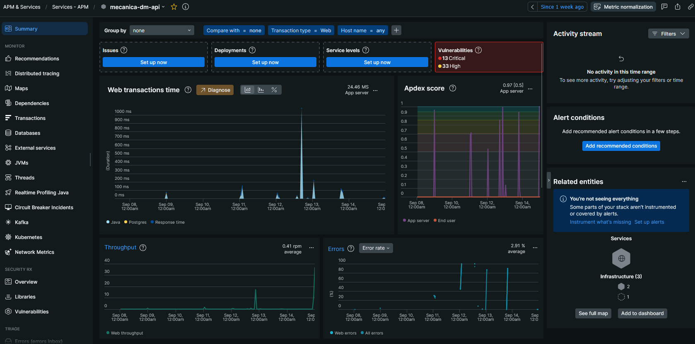
- Latência das APIs:
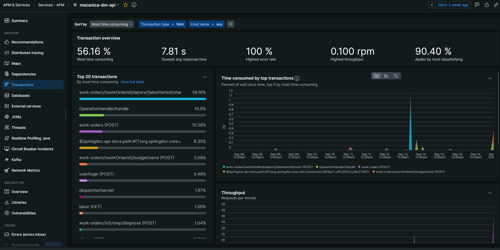
- CPU e Memória:
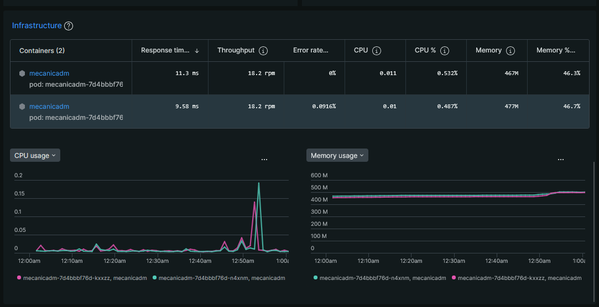
- Logs estruturados:
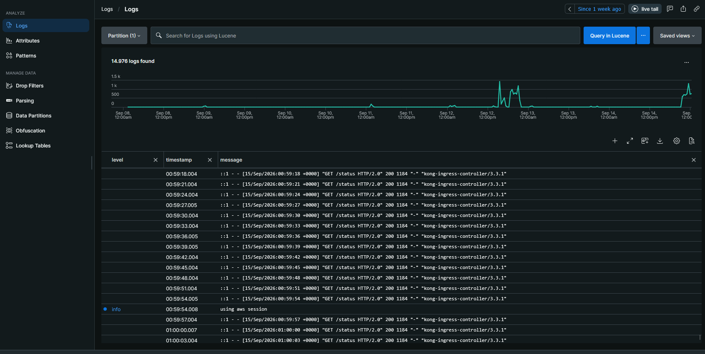
- Traces:
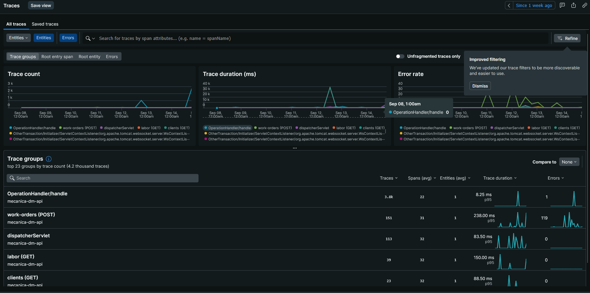
- Alerta de erro:
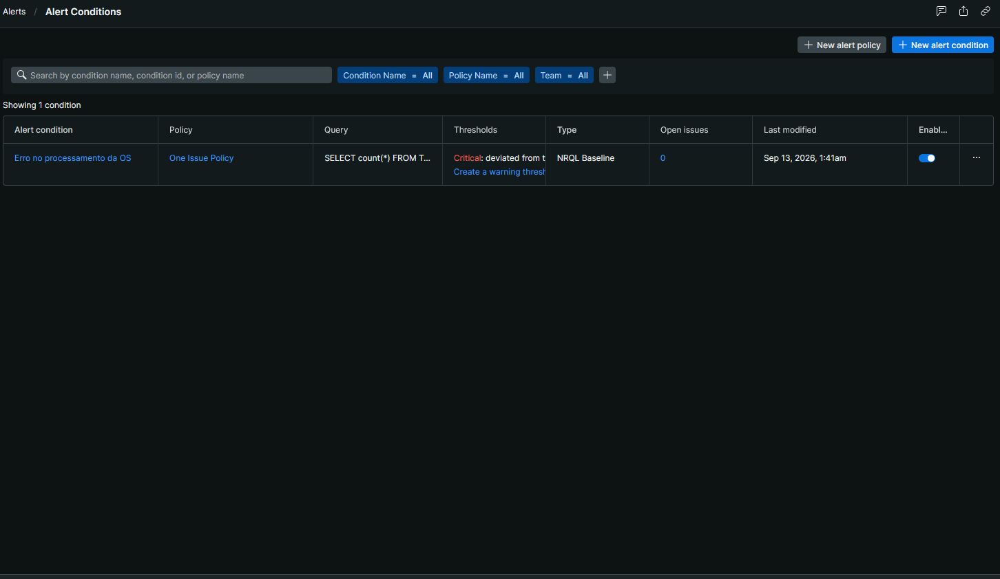
- Dashboard (Volume diário de OS, tempo médio de execução, Uptime, Erros da aplicação e mais!):
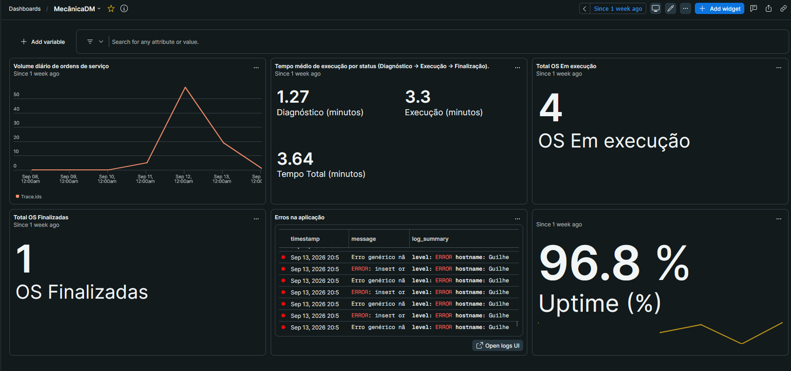
- Healthcheck:
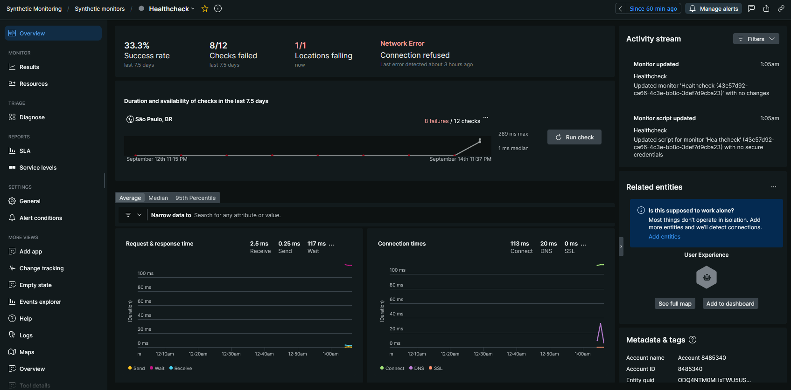

---

## 🏁 Como Começar

### Pré-requisitos

- [Docker](https://www.docker.com/get-started) e [Docker Compose](https://docs.docker.com/compose/install/) v2.20 ou mais novo. Não é preciso instalar Java nem Maven: a imagem compila o projeto.
- Opcional: copie `.env.example` para `.env` (`cp .env.example .env`). Sem `.env`, tudo sobe com valores de desenvolvimento.

A primeira subida compila a imagem e leva alguns minutos. Escolha abaixo como quer rodar.

<details>
<summary><b>🧪 Subir só a Workorder (isolada)</b></summary>

<br>

A API roda por conta própria, com o seu banco, e publica e escuta as mensagens normalmente. O que não existe, nesse modo, são as integrações com a Saga e o Finance.

1. **Suba o compose com o perfil `broker`**, na raiz deste projeto:

   ```bash
   docker compose --profile broker up -d --build
   ```

   Sobem o PostgreSQL, um **RabbitMQ próprio** com a topologia da Workorder (`messaging/workorder-definitions.json`), a API e o `seeder`, que popula o banco com usuário, clientes, veículos, mão de obra, materiais e OS de exemplo. O Flyway roda as migrações na subida.

   > 💡 Sem o perfil (`docker compose up -d --build`), sobem só o banco e a API, e você usa um broker que já exista (veja o fluxo completo, abaixo).

2. **Aguarde os containers ficarem saudáveis**: `docker compose ps`.

3. **Acesse**: API em `http://localhost:8080/api`, Swagger em `http://localhost:8080/api/swagger-ui/index.html` e painel do RabbitMQ em `http://localhost:15672` (`guest`/`guest`). Autentique-se com as credenciais da seção [Credenciais de Acesso Iniciais](#-credenciais-de-acesso-iniciais).

4. **Acompanhe as mensagens**, como uma fila de debug, no painel do RabbitMQ:
   - **Saída (eventos):** crie uma fila (por exemplo, `debug-out`) e faça o bind dela na exchange `workorder-output`, sem argumentos (casa com tudo).
   - **Entrada (commands):** crie a `debug-in` com o bind na `workorder-input`. Para simular um command, publique na `workorder-input` com os headers `message-id` (UUID) e `event-type` (por exemplo, `AuthorizeWorkOrderIntegrationCommand`) e o corpo `{"workOrderId": "<id da OS>"}`.

5. **Para parar**: `docker compose --profile broker down`. Para apagar também o volume do banco, acrescente `-v`.

> 💡 Este perfil publica as portas 5672 e 15672. Não o use junto com o broker da Saga, porque elas conflitam.

</details>

<details>
<summary><b>🔗 Subir todos os microsserviços (fluxo completo)</b></summary>

<br>

Para ver a OS percorrer o fluxo inteiro (diagnóstico, orçamento, aprovação, execução, pagamento e entrega), suba os três serviços, **nesta ordem**. Com as três pastas lado a lado, `./subir-tudo.sh`, na pasta que as contém, faz tudo.

| # | Pasta | Comando | O que sobe |
|---|---|---|---|
| 1 | `mecanicadm-saga-api-v4` | `docker compose --profile broker up -d --build` | MongoDB, **RabbitMQ com a topologia dos três serviços** e a Saga API (porta 8081) |
| 2 | `mecanicadm-workorder-api-v4` | `docker compose up -d --build` | PostgreSQL, Workorder API (porta 8080) e o seed de dados de exemplo |
| 3 | `mecanicadm-finance-api-v4` | `docker compose up -d --build` | PostgreSQL, Mailpit, Finance API (porta 8082) e o seed |

O broker é criado pelo compose da Saga, por isso ela sobe primeiro, e a Workorder o encontra em `host.docker.internal:5672`. O `JWT_SECRET` precisa ser o mesmo nos três serviços, porque esta API emite o token (login) que os outros validam.

As OS do seed entram direto no banco e **não têm saga**: para ver o fluxo completo, abra uma OS pela API.

Para usar um **broker externo** (como o CloudAMQP), não use o perfil `broker` da Workorder nem do Finance, suba a saga sem o perfil e defina, no `.env` de **cada um** dos três serviços, o mesmo `BROKER_HOST`, `BROKER_PORT` (5671 com TLS), `BROKER_USER`, `BROKER_PASSWORD`, `BROKER_VHOST` e `BROKER_SSL_ENABLED=true`. Importe antes a topologia `mecanicadm-saga-api-v4/messaging/rabbitmq-definitions.json` no broker.

</details>

---

## 📄 Documentação da API

Com a API em execução, a documentação interativa do Swagger UI fica disponível em:

**Local:** `http://localhost:8080/api/swagger-ui/index.html`

A especificação OpenAPI 3 pode ser acessada em `/api/v3/api-docs`.

### 🔑 Credenciais de Acesso Iniciais

- **Email**: `admin@mecanicadm.com`
- **Senha**: `Senha123`

Todos os endpoints (sob `/api`) exigem JWT (`Authorization: Bearer <token>`). São públicos: `POST /user` (cadastro), `POST /user/login`, `POST /user/forgot-password`, `POST /user/reset-password`, `GET /work-orders` (a listagem, público por requisito das entregas anteriores, mantido na evolução do produto), o Swagger e o Actuator.

### Principais Endpoints

A lista completa de endpoints pode ser consultada no Swagger UI. Abaixo estão os principais endpoints da aplicação.

#### 🔐 Autenticação e Usuários

| Método | Endpoint | Descrição |
|--------|----------|-----------|
| POST   | `/user/login` | Autentica o usuário e retorna o token JWT |
| POST   | `/user/forgot-password` | Solicita a recuperação de senha |
| POST   | `/user/reset-password` | Confirma a redefinição de senha via token |
| GET    | `/user/{id}` | Busca um usuário pelo ID |
| POST   | `/user` | Cria um novo usuário |
| PUT    | `/user` | Atualiza o usuário autenticado |
| DELETE | `/user` | Remove (soft delete) o usuário autenticado |

#### 👤 Clientes

| Método | Endpoint | Descrição |
|--------|----------|-----------|
| POST   | `/clients` | Cria um novo cliente |
| GET    | `/clients` | Lista clientes com filtros (`name`, `document`) e paginação |
| PUT    | `/clients/{id}` | Atualiza um cliente |
| DELETE | `/clients/{id}` | Remove (soft delete) um cliente |

#### 🚗 Veículos

| Método | Endpoint | Descrição |
|--------|----------|-----------|
| POST   | `/vehicle` | Cria um novo veículo |
| GET    | `/vehicle` | Lista veículos com filtros (`licensePlate`, `model`, `brand`, `modelYear`) e paginação |
| GET    | `/vehicle/{licensePlate}` | Busca um veículo pela placa |
| PUT    | `/vehicle/{licensePlate}` | Atualiza um veículo |
| DELETE | `/vehicle/{licensePlate}` | Remove um veículo |

#### 🛠️ Mão de Obra (Serviços)

| Método | Endpoint | Descrição |
|--------|----------|-----------|
| POST   | `/labor` | Cria um novo serviço/mão de obra |
| GET    | `/labor` | Lista serviços com filtro (`name`) e paginação |
| GET    | `/labor/{id}` | Busca um serviço pelo ID |
| PUT    | `/labor/{id}` | Atualiza um serviço |
| DELETE | `/labor/{id}` | Remove um serviço |

#### 📦 Materiais e Estoque

| Método | Endpoint | Descrição |
|--------|----------|-----------|
| POST   | `/materials` | Cria um novo material |
| GET    | `/materials` | Lista materiais com filtros (`name`, `brand`, `type`) e paginação |
| GET    | `/materials/{id}` | Busca um material pelo ID |
| PUT    | `/materials/{id}` | Atualiza um material |
| DELETE | `/materials/{id}` | Remove (soft delete) um material |
| GET    | `/stock-movements/{materialId}/statement` | Extrato de movimentações de estoque de um material |

#### 🔩 Ordens de Serviço

| Método | Endpoint | Descrição |
|--------|----------|-----------|
| POST   | `/work-orders` | Cria uma nova ordem de serviço |
| GET    | `/work-orders` | Lista O.S. em aberto com filtros (`clientId`, `licensePlate`) e paginação |
| GET    | `/work-orders/{id}` | Busca uma O.S. pelo ID |
| GET    | `/work-orders/{id}/status` | Consulta o status atual da O.S. |
| GET    | `/work-orders/{id}/history` | **Consulta o histórico de status da O.S.** (cada mudança, quem fez e quando) |
| PUT    | `/work-orders/{id}` | Atualiza uma O.S. (só em `RECEIVED` e `CHANGES_REQUESTED`) |

#### 🔄 Workflow de O.S.

| Método | Endpoint | Descrição |
|--------|----------|-----------|
| POST   | `/work-orders/{id}/step/diagnose` | Registra o diagnóstico da O.S. (a saga pede o orçamento) |
| POST   | `/work-orders/{id}/step/start-execution` | Inicia a execução da O.S. |
| POST   | `/work-orders/{id}/step/finish-execution` | Finaliza a execução da O.S. (todas as tarefas concluídas; a saga pede o pagamento) |
| POST   | `/work-orders/{id}/step/deliver` | Entrega a O.S. ao cliente |
| POST   | `/work-orders/{id}/step/cancel` | Cancela a O.S. (a saga compensa o que já foi feito) |

> A autorização da OS e a liberação do veículo (depois do pagamento) chegam como **commands da saga**, não por endpoint.

#### 🧰 Mão de Obra na O.S. e Materiais na O.S.

| Método | Endpoint | Descrição |
|--------|----------|-----------|
| POST   | `/work-orders/{workOrderId}/labors/{laborId}/add` | Adiciona um serviço à O.S. |
| POST   | `/work-orders/{workOrderId}/labors/{laborItemId}/start` | Inicia a execução do serviço |
| POST   | `/work-orders/{workOrderId}/labors/{laborItemId}/finish` | Finaliza a execução do serviço |
| GET    | `/work-orders/{workOrderId}/labors/{laborItemId}` | Busca um item de mão de obra da O.S. |
| POST   | `/work-orders/{workOrderId}/labors/{laborItemId}/remove` | Remove um serviço da O.S. |
| POST   | `/work-orders/{workOrderId}/materials/{materialId}/add` | Adiciona um material à O.S. (deduz do estoque) |
| POST   | `/work-orders/{workOrderId}/materials/{materialId}/remove` | Remove um material da O.S. |

#### 📊 Analytics

| Método | Endpoint | Descrição |
|--------|----------|-----------|
| GET    | `/analytics/work-orders/execution-time` | Relatório de tempo de execução das O.S. |
| GET    | `/analytics/labors/execution-time` | Relatório de tempo de execução dos serviços |

---

## ✅ Testes

O projeto possui uma suíte de testes unitários e de integração (Testcontainers com PostgreSQL e RabbitMQ) para garantir a qualidade e a estabilidade do código.

Para executar todos os testes via Maven:
```bash
mvn clean verify
```
Os relatórios de cobertura de testes (Jacoco) são gerados em `target/site/jacoco/`.

**Evidência de cobertura** (JaCoCo, `mvn verify`, 12/11/2026): **93,0% das linhas**, 93,4% das instruções e 80,7% dos branches, acima do mínimo de 80% do desafio. O CI publica o relatório no SonarCloud.

A estratégia de testes (pirâmide, nomenclatura, padrão dos testes de integração) está nos ADRs 007, 008 e 009.

---

## 📖 Documentação

- [`docs/arquitetura-geral.md`](docs/arquitetura-geral.md): visão geral do sistema, com os diagramas.
- [`docs/apoio/arquitetura-da-mensageria.md`](docs/apoio/arquitetura-da-mensageria.md): arquitetura da mensageria (outbox, inbox, topologia, garantias).
- [`docs/adr`](docs/adr), [`docs/rfc`](docs/rfc): decisões de arquitetura.
- [`docs/assets`](docs/assets): diagramas C4, ERD, sequência e fluxo de deploy (da Fase 03).
- [`../mecanicadm-saga-api-v4/docs/apoio/saga-fluxo.md`](../mecanicadm-saga-api-v4/docs/apoio/saga-fluxo.md): o fluxo da saga e a topologia dos três serviços.
