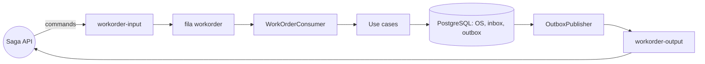
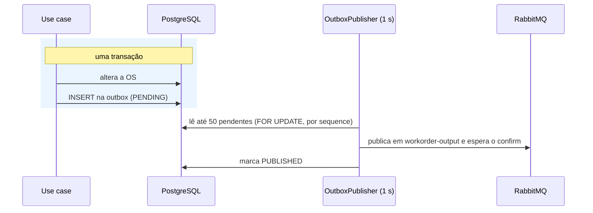
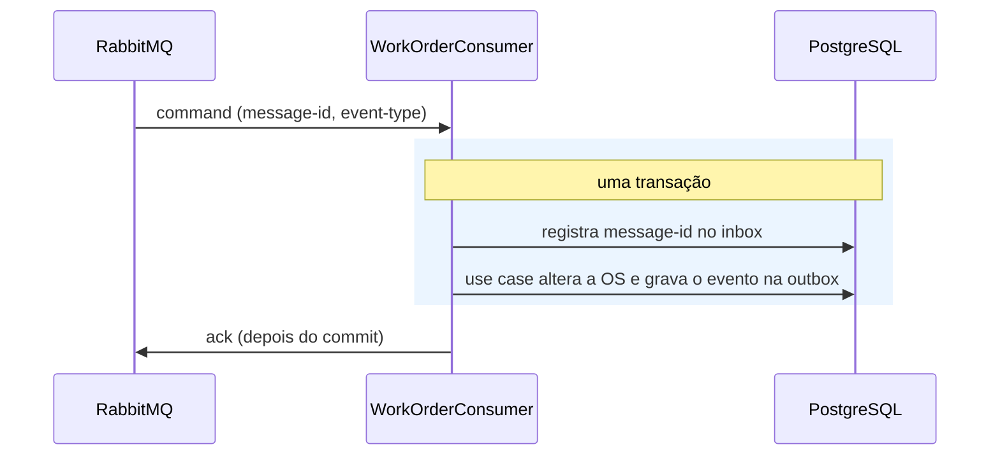

# Arquitetura da mensageria da Workorder API

Documento de arquitetura da integração da `mecanicadm-workorder-api-v4` com a saga pelo RabbitMQ. Ele resume e aponta: as decisões
estão nos ADRs [012](adr/012-evento_de_recusa_de_command.md) e [013](adr/013-outbox_inbox_e_politica_de_ack.md), e a visão dos
três serviços está em [arquitetura-geral.md](arquitetura-geral.md). A explicação didática, do zero, está em
[apoio/messaging-fluxo-completo.md](apoio/messaging-fluxo-completo.md).

| | |
|---|---|
| **Serviço** | Workorder API (dona da Ordem de Serviço) |
| **Status** | Vigente |
| **Atualizado em** | 12/11/2026 |

## 1. Objetivos

| Objetivo | Como a arquitetura responde |
|---|---|
| Nenhum evento se perde, mesmo com o broker fora do ar | **Outbox**: o evento é gravado no banco na mesma transação da mudança da OS |
| Nenhum command é executado duas vezes | **Inbox**: o `message-id` é registrado na mesma transação do efeito |
| A saga sabe quando um command é recusado | `WorkOrderCommandRejectedEvent`, gravado na outbox ([ADR 012](adr/012-evento_de_recusa_de_command.md)) |
| O núcleo de negócio não conhece o broker | Porta `MessagePublisher` no `core`, implementada na `infra` |

## 2. Contexto

A Workorder consome **4 commands** e publica **11 eventos**, todos listados na seção 5. Ela não conhece o Finance: só a saga.

## 3. Contrato da mensagem

| Elemento | Onde vai | Conteúdo |
|---|---|---|
| `message-id` | header | UUID da mensagem; chave do inbox e `id` da linha na outbox |
| `event-type` | header | Nome da classe da mensagem; é o que o broker usa para rotear |
| `timestamp` | propriedade AMQP | Momento da publicação (UTC) |
| Corpo | JSON | `workOrderId` mais os campos próprios da mensagem |

Os metadados de transporte nunca vão no corpo. Não há `correlationId` nem `version`: o `workOrderId` identifica a saga.

## 4. Topologia

Exchanges `headers`, roteadas pelo `event-type`, definidas em `messaging/workorder-definitions.json` (a aplicação não declara
topologia). A definição **conjunta dos três serviços** está em `messaging/rabbitmq-definitions.json` no repositório da saga
(ver o ADR 010 dela).

| Elemento | Papel |
|---|---|
| `workorder-input` | Recebe os commands da saga (via bind `saga-output` → `workorder-input`) |
| fila `workorder` | Uma fila, com um bind por command; um único consumer (`concurrency=1`) |
| `workorder.dlq` | DLQ da fila, ligada a `mecanicadm.dlx` |
| `workorder-output` | Recebe os eventos da Workorder e os entrega à fila `saga.workorder-events` |

## 5. Mensagens

### Commands recebidos

| `event-type` | Efeito na OS |
|---|---|
| `CancelWorkOrderIntegrationCommand` | Cancela em qualquer status e devolve o estoque (idempotente se já cancelada) |
| `AuthorizeWorkOrderIntegrationCommand` | `DIAGNOSED` → `AWAITING_EXECUTION` |
| `ChangesRequestedWorkOrderIntegrationCommand` | Vai para `CHANGES_REQUESTED` (campo `observation`) |
| `ReleaseWorkOrderVehicleIntegrationCommand` | `EXECUTION_COMPLETED` → `PAID` |

### Eventos publicados

| `event-type` | Quando |
|---|---|
| `WorkOrderCreatedEvent`, `WorkOrderUpdatedEvent` | OS criada ou alterada; **levam os dados da OS** (cliente, veículo, tarefas, materiais) |
| `WorkOrderDiagnosedEvent` | Diagnóstico feito |
| `WorkOrderAuthorizedEvent` | Command `Authorize` aceito |
| `WorkOrderChangesRequestedEvent` | Command `RequestChanges` aceito (`observation`) |
| `WorkOrderExecutionStartedEvent`, `WorkOrderExecutionFinishedEvent` | Início e fim da execução |
| `WorkOrderVehicleReleasedEvent`, `WorkOrderVehicleDeliveredEvent` | Veículo liberado e entregue |
| `WorkOrderCanceledEvent` | OS cancelada |
| `WorkOrderCommandRejectedEvent` | Command recusado por regra de negócio (`eventType`, `exception`, `message`) |

Os eventos `Created` e `Updated` carregam os dados porque a saga os guarda para pedir o orçamento. Os totais **não** são
calculados aqui: quem gera o orçamento soma.

## 6. Execução

### 6.1 Saída (evento)

### 6.2 Entrada (command)

### 6.3 Situações

| Situação | Resultado | Ack |
|---|---|---|
| Normal | Inbox, OS e outbox no mesmo commit | Sim |
| Duplicata (`PROCESSED`) | Não executa nada | Sim |
| Recusa de negócio ou OS inexistente | Transação desfeita; o inbox registra `REJECTED` e a outbox recebe o `WorkOrderCommandRejectedEvent` em uma segunda transação; reenvio é reprocessado | Sim |
| Falha técnica | Transação desfeita; inbox `FAILED`; mensagem vai para a DLQ; sem retry | Nack |
| Mensagem inválida (JSON, `message-id`, `workOrderId` ou `event-type` ausente ou desconhecido) | Vai direto para a DLQ | Nack |

**Por que o ack só depois do commit:** com ack antes, uma queda no meio perderia o command. Com ack depois, o pior caso é uma
duplicata, que o inbox neutraliza.

## 7. Dados

| Tabela | Conteúdo |
|---|---|
| `outbox` | `id` (= `message-id`), `sequence` (ordem), `aggregate_id`, `type`, `payload`, `status` (`PENDING`, `PUBLISHED`, `FAILED`), `published_at`, `last_error` |
| `inbox` | `message-id`, tipo, `workOrderId`, `status` (`PROCESSED`, `REJECTED`, `FAILED`), `error`, `processed_at` |

Só `PROCESSED` é duplicata; `REJECTED` e `FAILED` podem ser reprocessados.

## 8. Peças do código

| Peça | Camada | Papel |
|---|---|---|
| `MessagePublisher` | core | Porta de publicação: `publish(workOrderId, mensagem)` |
| Eventos (`record`) | core | O corpo das mensagens de saída |
| Integration commands (`toCommand()`) | infra | O contrato do que chega; convertem no command do use case |
| `OutboxMessagePublisher` | infra | Implementa a porta; `INSERT` na outbox (exige transação) |
| `OutboxPublisher` | infra | Publica em lote e limpa as publicadas há mais de 7 dias |
| `RabbitOutboxMessageSender` | infra | Envia e espera o confirm (5 s) |
| `MessageConsumer` / `MessageConsumerSupport` | infra | Base de todo consumer: inbox, transação, ack, recusa, falha |
| `WorkOrderConsumer` | infra | Um `@RabbitHandler` por command |
| `RabbitMQConfig` | infra | Conversor por `event-type`, template e fábrica de listeners |
| `TransactionalProxy` | infra | Abre a transação em volta dos use cases |

Para criar um consumer novo: command e use case no `core`, integration command na `infra`, entrada em `COMMANDS` do
`RabbitMQConfig`, bind em `workorder-definitions.json` e um `@RabbitHandler` no `WorkOrderConsumer`.

## 9. Configuração

| Variável | Padrão | Efeito |
|---|---|---|
| `OUTBOX_SCHEDULER_ENABLED` | `true` | Liga a publicação da outbox |
| `OUTBOX_PUBLISHER_INTERVAL_MS` | `1000` | Intervalo entre rodadas |
| `OUTBOX_BATCH_SIZE` | `50` | Linhas por lote |
| `OUTBOX_CONFIRM_TIMEOUT_MS` | `5000` | Espera pelo confirm |
| `OUTBOX_RETENTION_DAYS`, `OUTBOX_CLEANUP_CRON` | `7`, `0 0 3 * * *` | Retenção e horário da limpeza |
| `CONSUMER_PREFETCH` | `10` | Mensagens recebidas adiantadas |

## 10. Garantias e limitações

| Garantia | Como |
|---|---|
| Nenhum evento se perde | Está no banco junto com a mudança da OS |
| Nenhum command executa duas vezes | Inbox na mesma transação do efeito |
| Nenhum efeito pela metade | Inbox, OS e outbox confirmados juntos |
| Nenhum command se perde | Ack depois do commit; falha vai para a DLQ |
| Ordem dos eventos | `sequence` da outbox, com `FOR UPDATE` entre instâncias |

| Limitação | Consequência |
|---|---|
| Entrega pelo menos uma vez | O receptor precisa deduplicar pelo `message-id` |
| Sem retry | Falha momentânea vira `FAILED` na outbox ou no inbox e exige reenvio manual (voltar a `PENDING` ou reenviar da DLQ) |
| Um consumer só na fila | Throughput de commands limitado a uma thread; a ordem é preservada |
| Sem `version` na mensagem | O receptor não descarta evento velho que chegue atrasado |
| Evento posterior pode sair antes de um anterior `FAILED` | A ordem pode ser quebrada nesse caso |
| Mensagem sem binding é descartada pelo broker | Um tipo novo precisa entrar na definição de topologia |
| Command para OS inexistente | Recusa registrada, mas sem evento (não há OS a que atribuí-lo) |
