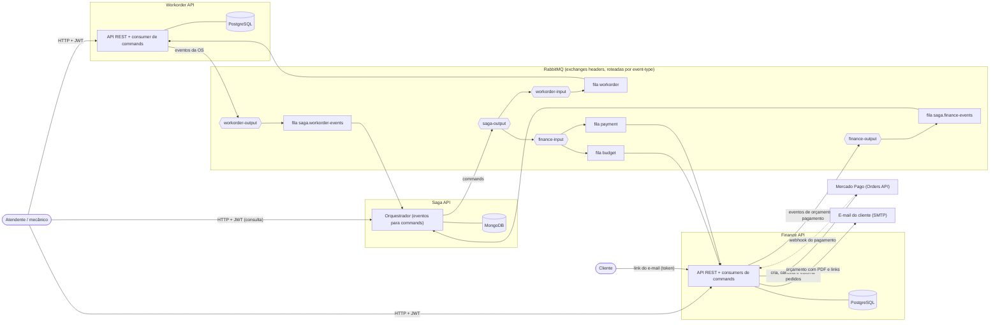
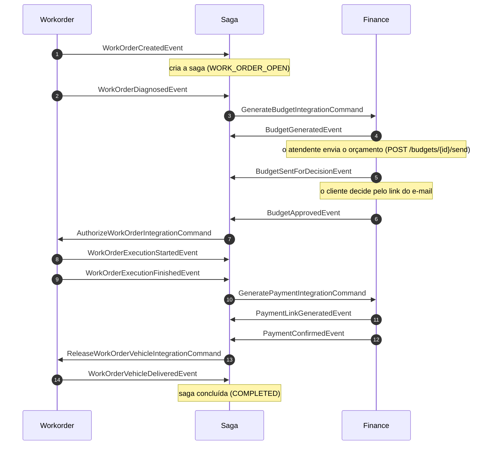
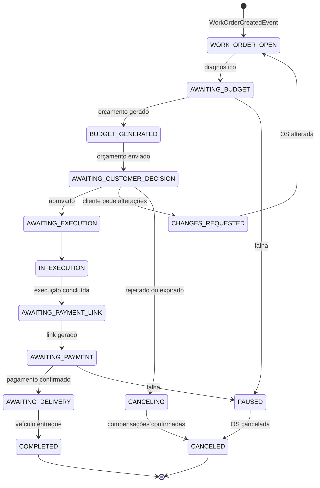

# Arquitetura geral do sistema Mecânica DM

> Este documento é idêntico nos três repositórios (Workorder API, Finance API e Saga API), porque cada serviço tem o seu repositório e precisa ser entendido sozinho. Ao mudar um, atualize os três.

O sistema é composto por **três microsserviços independentes**, cada um com o seu repositório, o seu banco e o seu pipeline. Nenhum serviço acessa o banco de outro nem chama outro por HTTP: toda a integração é por **mensageria assíncrona (RabbitMQ)**, e a consistência entre os serviços é garantida por uma **saga orquestrada**.

| Serviço | Papel | Banco | Tipo |
|---|---|---|---|
| **Workorder API** (OS Service) | Cadastros, abertura e ciclo de vida da OS, fila de execução, estoque | PostgreSQL | Relacional |
| **Finance API** (Billing Service) | Orçamento (geração, envio ao cliente, decisão) e pagamento (Mercado Pago) | PostgreSQL | Relacional |
| **Saga API** (orquestrador) | Conduz o fluxo da OS entre os dois serviços e desfaz o que já foi feito quando algo falha | MongoDB (replica set) | NoSQL |

## Visão geral: serviços, bancos e comunicação

Cada fila tem a sua DLQ (`<fila>.dlq`). A topologia completa dos três serviços está em `mecanicadm-saga-api-v4/messaging/rabbitmq-definitions.json`.

## Como o sistema conversa

- **Eventos** (passado: "isto aconteceu") saem de cada serviço pela sua exchange de saída e chegam à saga. **Commands** (pedido: "faça isto") saem da saga pela `saga-output` e chegam ao serviço de destino.
- O nome da classe da mensagem vai no header `event-type`, e o identificador único, no header `message-id`. O `workOrderId` identifica a OS em tudo.
- **Outbox**: o evento é gravado no banco do serviço, na mesma transação da mudança, e um publicador o envia ao RabbitMQ. **Inbox**: cada mensagem recebida é registrada pelo `message-id`, e a repetida é ignorada. Assim a entrega *at-least-once* do RabbitMQ vira processamento *effectively-once*.
- O Finance também recebe o **webhook do Mercado Pago** (rota pública protegida por assinatura) com o resultado dos pagamentos, e uma rotina de consulta o reconcilia.
- Quando um serviço recusa um command por regra de negócio, publica um evento de recusa (`WorkOrderCommandRejectedEvent` ou `FinanceCommandRejectedEvent`), e a saga decide o que fazer. Falha técnica não gera evento: a mensagem vai para a DLQ.
- As APIs HTTP exigem o **mesmo JWT**, emitido pelo login da Workorder (segredo `JWT_SECRET` compartilhado). Cada README lista as poucas rotas públicas, como o link de decisão do orçamento que o cliente recebe por e-mail, protegido pelo token do próprio link.

## O caminho feliz de uma OS

Se o cliente rejeitar o orçamento, ou algo for recusado, a saga **compensa**: cancela o orçamento, o link de pagamento ou estorna o pagamento, pede o cancelamento da OS e só encerra (`CANCELED`) quando cada compensação é confirmada.

## Estados da saga

O diagrama mostra os caminhos principais. A tabela completa de transições (evento, estado, command emitido e novo estado) está em `mecanicadm-saga-api-v4/docs/apoio/saga-fluxo.md`.

## Por que esta divisão

- **Workorder x Finance:** a OS e o dinheiro mudam por motivos e em ritmos diferentes. O orçamento e o pagamento têm integração externa (Mercado Pago, e-mail) e regras próprias, e podem falhar sem derrubar o atendimento da oficina.
- **Saga separada:** quem conhece o fluxo inteiro é a saga. A Workorder e o Finance só dizem o que aconteceu no seu domínio, e não sabem um do outro. Isso permite mudar o fluxo (e as compensações) em um só lugar. A escolha está justificada na RFC 001 da Saga API.
- **Bancos:** PostgreSQL onde há dado relacional e transacional (OS, estoque, orçamento, pagamento). MongoDB na saga, porque o estado dela é um documento (estado, retrato da OS e histórico embutido) que se grava junto com a outbox em uma transação.
